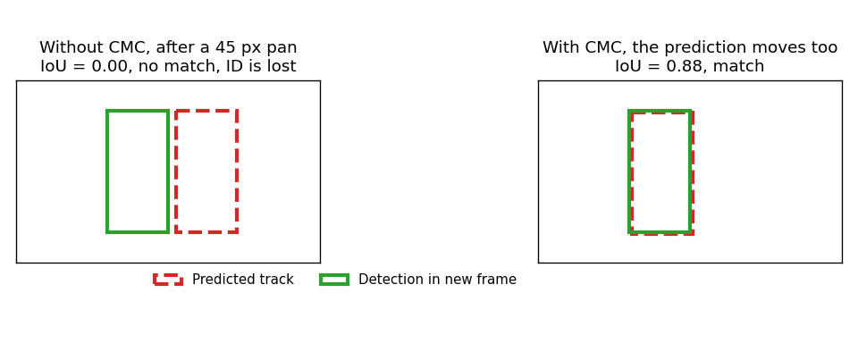
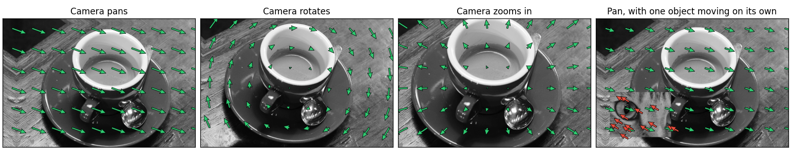
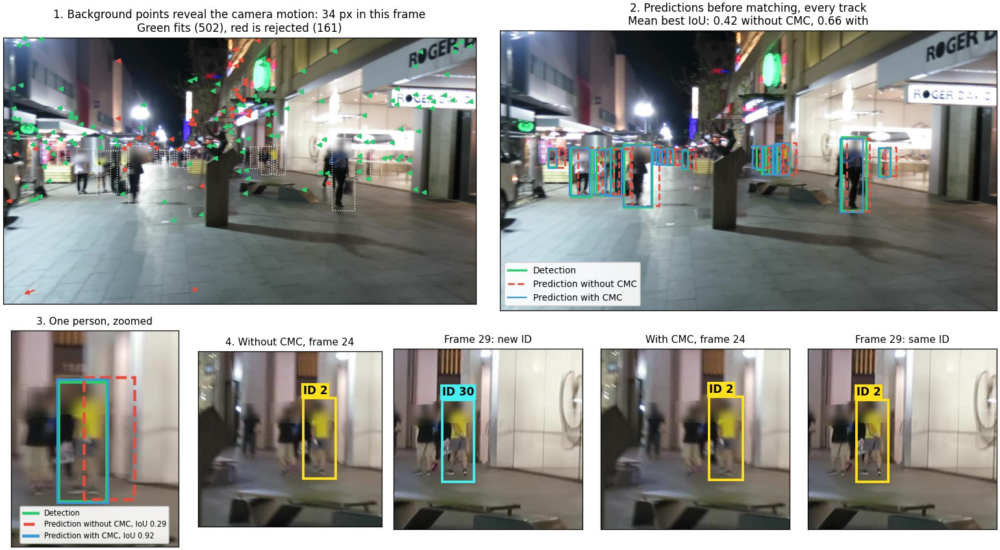
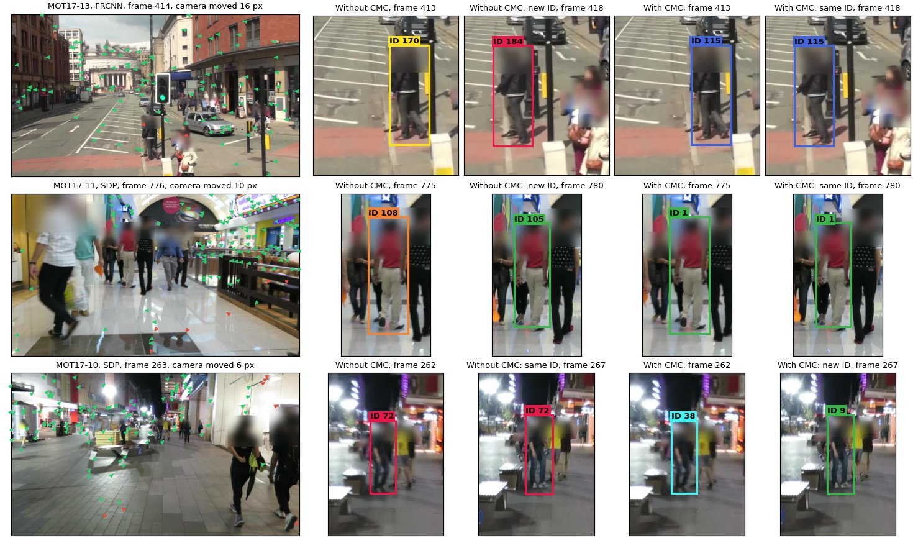
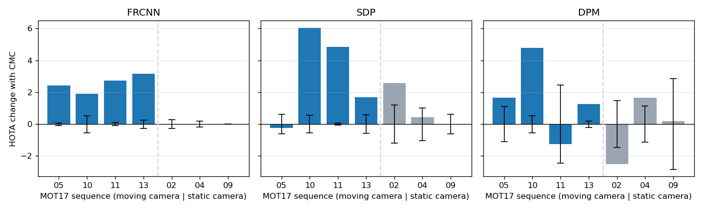

# Camera Motion Compensated Tracking

[](https://github.com/mstftmk/camera-motion-compensated-tracking/actions/workflows/tests.yml)

**Global motion compensation (GMC)**, also called camera motion compensation (CMC), keeps a tracker working when the camera itself moves. This repo is a from-scratch implementation of the [OC-SORT](https://github.com/noahcao/OC_SORT) multi-object tracker with optional GMC, compared with and without it on the MOT17 pedestrian tracking dataset.



**Result:** on moving-camera sequences, CMC raised HOTA by 2.42 points on average, and the rise exceeded a noise control in 10 of 12 cases. On static-camera sequences there was no reliable effect, as expected.

| Detector | Tracker | HOTA | IDF1 | AssA | DetA | MOTA | ID switches |
|---|---|---:|---:|---:|---:|---:|---:|
| FRCNN | Official OC-SORT | 46.97 | 54.40 | 50.67 | 43.70 | 48.06 | 463 |
| FRCNN | This repo | 46.96 | 54.45 | 50.66 | 43.69 | 48.05 | 464 |
| FRCNN | This repo + CMC | 47.89 | 55.60 | 52.53 | 43.80 | 48.36 | 342 |
| SDP | Official OC-SORT | 50.45 | 61.35 | 49.97 | 51.07 | 60.18 | 819 |
| SDP | This repo | 50.60 | 61.44 | 50.28 | 51.05 | 60.20 | 815 |
| SDP | This repo + CMC | 52.28 | 64.08 | 53.60 | 51.10 | 60.54 | 638 |
| DPM | Official OC-SORT | 25.77 | 33.04 | 28.59 | 23.30 | 27.24 | 595 |
| DPM | This repo | 25.30 | 32.54 | 27.60 | 23.26 | 27.18 | 617 |
| DPM | This repo + CMC | 26.38 | 34.01 | 30.06 | 23.22 | 27.04 | 608 |

These are the MOT17 training set scores over all 7 sequences, measured with [TrackEval](https://github.com/JonathonLuiten/TrackEval) on the public detections that come with the dataset. Published OC-SORT scores use a different, stronger detector, so they are not comparable with this table.

## What is global motion compensation?

**What it is.** Motion compensation removes a known motion before frames are compared. *Global* means one transformation describes the whole image, because the camera moved, unlike the separate motion of each person or car. Tracking papers call it camera motion compensation (CMC), and the BoT-SORT code calls it GMC. Video encoders also use motion compensation, but per block and to predict pixels, which is a different job.



*Green arrows show the camera motion estimated from the image, drawn to scale. A pan gives parallel arrows, a rotation gives circular ones, and a zoom gives arrows pointing away from the center. In the last panel an object moves on its own: its arrows (red) disagree with the camera, and RANSAC rejected all 121 of its points. These motions were applied to the photo on purpose, and the estimate recovered each one with under 0.1 px of error. `scripts/make_gmc_arrows.py` reproduces this. Photos from scikit-image: "coffee" (CC0, Rachel Michetti, courtesy of Pikolo Espresso Bar) and "chelsea" (CC0, Stefan van der Walt).*

**Why it is needed.** A tracker like this predicts where each person will be in the next frame, then matches predictions to new detections by box overlap (IoU). The prediction only knows how the person moves in the image. When the camera moves, everyone shifts in the image at once, so predictions can miss their detections and the person gets a new ID. The first figure on this page shows this with a 45 px pan. In the MOT17 sequences used here, the moving cameras shift the image by a median of 3.7 to 8 px per frame, reaching about 45 px in sequence 13, which was filmed from a bus.

**What it gains and costs here:**

| Effect | Result |
|---|---|
| ID stability, moving camera | +3.19 IDF1 and about 30 fewer ID switches per case on average |
| Overall tracking, moving camera | +2.42 HOTA on average |
| Static camera | No reliable effect, so it can be left off |
| Detection quality | Almost unchanged: it does not find more people |
| Time per 1080p frame, CPU | About 9 ms to estimate the motion, and about 1.5 ms more in the tracker |

**What it does not fix.** One transformation cannot describe parallax, where nearby and far objects shift by different amounts. It does not help when a person is hidden, or tell apart two people who cross, and it can occasionally break an ID that would have survived without it. See [Results](#results).

## How it works

**OC-SORT** extends SORT, a Kalman filter tracker, with three ideas for when a person is briefly lost:

- **Direction consistency:** a match is rewarded when it continues the person's recent direction.
- **Recovery from the last observation:** leftover detections are retried against each track's last real box, not only its prediction.
- **Re-update after a gap:** when a lost person returns, the filter rolls back and replays a straight path across the gap, which removes the error built up while predicting blind.

**Camera motion compensation** (GMC in the BoT-SORT code) runs once per frame, before matching:

1. Find corner points in the previous frame, ignoring the boxes of detected people.
2. Follow them into the current frame with sparse optical flow, and drop points that do not return to their start when tracked backward.
3. Fit a shift, rotation and zoom with RANSAC, which ignores points that disagree.
4. If too few points agree, use no correction for that frame, because a wrong correction moves every track.
5. Move each track's Kalman state and stored observations into the current frame's coordinates.

This follows the common recipe used by trackers such as BoT-SORT. On synthetic images with known motion, it recovers the shift, rotation and zoom within half a pixel.

## Real examples

### One frame, step by step



*MOT17-10 with FRCNN detections. **1:** background points give a 34 px camera jump. **2:** predictions for every track before matching. Without CMC (red) they sit beside the detections (green), and with CMC (blue) they land on them: the mean best IoU rises from 0.42 to 0.66. **3:** for this person, IoU is 0.29 without CMC, just under the 0.30 threshold, and 0.92 with it. **4:** without CMC the person gets a new ID, and with CMC the ID stays. The ground truth labels confirm it is the same person. This frame was picked because it shows the effect clearly, so it is not typical: see [Results](#results) for the net effect. Frame from [MOT17](https://motchallenge.net/data/MOT17/), [CC BY-NC-SA 3.0](https://creativecommons.org/licenses/by-nc-sa/3.0/); changed by blurring heads and adding overlays.*

### More scenes



*Each row starts with the camera motion, followed by the same person in two frames, without and with CMC. **Top two rows:** the ID survives only with CMC. **Bottom row:** a failure, where the ID survives only without CMC. Every example was confirmed with the ground truth labels to be the same clearly visible person. They are picked examples, chosen as the largest confirmed person in each group. Frames from [MOT17](https://motchallenge.net/data/MOT17/), [CC BY-NC-SA 3.0](https://creativecommons.org/licenses/by-nc-sa/3.0/); changed by blurring heads and adding overlays.*

## Results

| Camera | Cases | Mean HOTA change | Mean IDF1 change | Mean ID switch change | HOTA rose beyond noise |
|---|---:|---:|---:|---:|---:|
| Moving | 12 | +2.42 | +3.19 | -29.9 | 10 of 12 |
| Static | 9 | +0.26 | +0.45 | +5.7 | 2 of 9 |

A case is one sequence with one detector.



*Bars show the HOTA change with CMC. Blue is a moving camera, gray is static. Black whiskers show the noise control. Sequences are labeled moving or static by their measured camera shift: a median of 3.7 to 8 px per frame against at most 0.16 px.*

How to read this:

- **The gain is in association, not detection.** AssA rises while DetA stays almost flat, because CMC does not change which people are found, only whether they keep the same ID.
- **The gain depends on the sequence.** Sequence 10 gains the most (+6.04 HOTA with SDP). Two moving cases got worse or did not clearly change: sequence 05 with SDP and sequence 11 with DPM.
- **CMC also breaks some IDs.** Over the moving sequences, comparing IDs 5 frames apart, 167 steps stayed the same only with CMC and 106 only without it using FRCNN. With SDP the counts are 492 and 285. Counting only cases that the ground truth labels confirm as the same clearly visible person, sequences 10, 11 and 13 give 76 against 23 with FRCNN and 181 against 62 with SDP. The gain is a net effect, not a pure win.
- **The weak DPM detector is the least reliable.** With DPM, the noise control itself reaches 2.84 points, and static sequence 02 fell by 2.52. Small gains there should not be trusted.

<details>
<summary>All sequences</summary>

| Sequence | Camera | Detector | HOTA change | Noise | IDF1 change | ID switch change |
|---|---|---|---:|---:|---:|---:|
| 05 | Moving | DPM | +1.66 | 1.09 | +2.88 | -24 |
| 05 | Moving | FRCNN | +2.43 | 0.07 | +2.99 | -13 |
| 05 | Moving | SDP | -0.23 | 0.62 | +0.57 | -23 |
| 10 | Moving | DPM | +4.78 | 0.53 | +7.70 | -41 |
| 10 | Moving | FRCNN | +1.89 | 0.54 | +2.53 | -53 |
| 10 | Moving | SDP | +6.04 | 0.56 | +9.87 | -113 |
| 11 | Moving | DPM | -1.26 | 2.45 | -2.92 | +12 |
| 11 | Moving | FRCNN | +2.74 | 0.10 | +2.45 | -8 |
| 11 | Moving | SDP | +4.84 | 0.07 | +5.74 | -20 |
| 13 | Moving | DPM | +1.26 | 0.20 | +1.51 | -7 |
| 13 | Moving | FRCNN | +3.17 | 0.26 | +4.22 | -51 |
| 13 | Moving | SDP | +1.68 | 0.58 | +0.71 | -18 |
| 02 | Static | DPM | -2.52 | 1.47 | -3.52 | +26 |
| 02 | Static | FRCNN | -0.00 | 0.26 | +0.10 | +3 |
| 02 | Static | SDP | +2.58 | 1.19 | +3.42 | +0 |
| 04 | Static | DPM | +1.65 | 1.14 | +2.38 | +23 |
| 04 | Static | FRCNN | +0.00 | 0.18 | +0.00 | +0 |
| 04 | Static | SDP | +0.43 | 1.03 | +0.84 | -3 |
| 09 | Static | DPM | +0.20 | 2.84 | +0.83 | +2 |
| 09 | Static | FRCNN | +0.00 | 0.00 | +0.00 | +0 |
| 09 | Static | SDP | +0.00 | 0.61 | +0.00 | +0 |

</details>

## How the results were checked

**Against the official code.** Without CMC, this implementation was run next to the official OC-SORT on the same detections with the same settings. Totals are within 0.01 HOTA with FRCNN, 0.15 with SDP and 0.47 with DPM. The largest gap on one sequence is 0.58, 0.42 and 2.59. Comparing the two led to aligning two details of the matching and re-update steps, and these changes apply equally to the tracker with and without CMC.

**Against noise.** Trackers are chaotic: one changed match can change everything after it. The control feeds the tracker random shifts of about 0.15 px with no real camera motion, using 3 seeds. The noise value is the largest HOTA change it caused. A real gain should exceed it.

**No tuning for this comparison.** Tracker settings follow the OC-SORT paper, and the score thresholds and GMC settings were fixed before seeing any tracking result. Note that this is the training set: its labels are public, and MOT17 test labels are not. The 12 moving cases also come from only 4 scenes, so they are not independent.

**The code.** 51 tests check known answers, such as IoU values, recovered camera motion and ID behavior in simulated pans. Deliberately breaking 11 key parts of the code made the tests fail in every case.

## Use

```bash
git clone https://github.com/mstftmk/camera-motion-compensated-tracking.git
cd camera-motion-compensated-tracking
pip install -e ".[dev]"
pytest
```

```python
from cmc_tracking import OCSort, estimate_camera_motion

tracker = OCSort()
previous_gray = None
for gray, detections in video:  # detections: rows of [x1, y1, x2, y2, score]
    affine = None
    if previous_gray is not None:
        affine = estimate_camera_motion(previous_gray, gray, previous_boxes).affine
    tracks = tracker.update(detections, affine)  # rows of [x1, y1, x2, y2, id]
    previous_gray, previous_boxes = gray, detections[:, :4]
```

## Reproducing the results

Download [MOT17Det.zip and MOT17Labels.zip](https://motchallenge.net/data/MOT17/) and extract them to `MOT17/images` and `MOT17/labels`. MOT17 is licensed CC BY-NC-SA 3.0, which applies to the data and not to this code.

```bash
python scripts/run_mot17.py --data MOT17 --out results
python scripts/run_noise_control.py --data MOT17 --out results
python scripts/run_reference.py path/to/OC_SORT MOT17 results
python scripts/evaluate_mot17.py --data MOT17 --out results
pip install -e ".[results]"
python scripts/summarize_results.py --results results
python scripts/make_real_examples.py --data MOT17 --results results --out docs
python scripts/make_real_examples.py --data MOT17 --results results --out docs --gallery
python scripts/make_cmc_diagram.py
python scripts/make_gmc_arrows.py
```

TrackEval and the official OC-SORT are separate downloads. TrackEval needs an older NumPy; these results used NumPy 1.23.5 and SciPy 1.10.1. All scores are saved in `docs/mot17_metrics.csv`.

## References

- Y. Cao et al., "Observation-Centric SORT: Rethinking SORT for Robust Multi-Object Tracking", CVPR 2023. [Official code](https://github.com/noahcao/OC_SORT), MIT license.
- N. Aharon, R. Orfaig and B.-Z. Bobrovsky, "[BoT-SORT: Robust Associations Multi-Pedestrian Tracking](https://arxiv.org/abs/2206.14651)", 2022.
- J. Luiten et al., "HOTA: A Higher Order Metric for Evaluating Multi-object Tracking", IJCV 2021.
- A. Milan et al., "MOT16: A Benchmark for Multi-Object Tracking", 2016. MOT17 uses the same sequences with more accurate ground truth.

## License

The code is MIT. `docs/mot17_example.jpg` and `docs/mot17_gallery.jpg` are derived from MOT17 and are licensed separately under [CC BY-NC-SA 3.0](https://creativecommons.org/licenses/by-nc-sa/3.0/). The dataset itself is not included.
